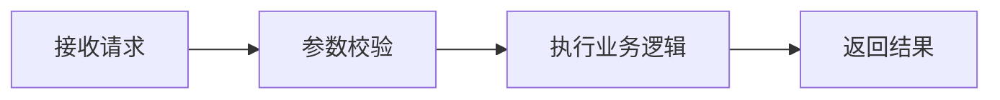

# HHS 博客

基于 VuePress 2 和 [VuePress Theme Hope](https://theme-hope.vuejs.press/zh/guide/) 的中文博客。

## 本地开发

使用 `.nvmrc` 指定的 Node.js 24.19.0（VuePress 要求 Node.js 22.18.0 及以上）。

```bash
npm ci
npm run docs
```

开发服务默认使用 9090 端口，站点路径为 `/blog/`。

```bash
npm run docs:build
```

静态产物位于 `docs/.vuepress/dist`，供 GitHub Pages 使用。仓库中的两套构建配置均使用新版 Node 和 `npm ci`；请保留并提交 `package-lock.json`。

GitHub 部署工作流使用自动生成的 `GITHUB_TOKEN` 和 `contents: write` 权限，将静态产物推送到 `gh-pages` 分支。GitHub Pages 的发布来源应设置为该分支的根目录。

## 站点配置

- 配置入口：`docs/.vuepress/config.js`，使用 ESM、Vite 和 Hope 主题。
- 版本固定为 VuePress `2.0.0-rc.31`、Hope `2.0.0-rc.110`；两者仍为候选版本，升级时需核对兼容性。
- 首页采用自定义 `CardHome` 布局，以扑克牌交互串联学习资源、工程实践、开发工具和 AI 实践；入口位于 `docs/.vuepress/client.js`，组件位于 `layouts/CardHome.vue`，样式位于 `styles/card-home.scss`。
- 首页主牌支持点击翻面和鼠标倾斜反光，花色牌打开原生专题对话框；对话框支持 Escape、遮罩关闭和栏目切换。手机使用单列舞台、两列专题牌和折叠菜单，系统的减少动态效果偏好会关闭入场动画与指针倾斜。
- 首页文章、栏目计数与专题最近文章均来自 Hope 博客插件，不需要另行维护文章清单；按日期倒序展示，未注明日期的文章排在最后。栏目筛选覆盖生活记录，使用“再翻六篇”继续浏览。
- 参考站的结构、动效和适配取舍见 `design/trae-homepage.md`。运行 `npm test` 验证首页的数据排序、筛选和日期处理。
- 顶部导航定义在 `docs/.vuepress/navbar.js`，侧边栏在 `docs/.vuepress/sidebar.js` 按主题分组。
- 实践笔记按开发与集成、故障排查、性能优化三个专题组织；导航和侧栏共用 `docs/.vuepress/practice.js`，专题目录位于 `docs/tips/` 下，文章继续使用原有地址。
- 主分类统一为学习资源、开发工具、实践笔记、AI 实践、生活记录；标签同时描述技术主题与文档用途。
- 文章元数据使用 `category`、`tag` 和 `YYYY-MM-DD` 格式的 `date`。
- 时间线汇总正文文章；有日期的文章按年份和日期倒序排列，无日期的文章显示在未注明日期分组。首页侧栏与时间线页面使用同一份数据，`timeline: false` 可排除特定文章。
- 时间线逻辑位于 `docs/.vuepress/timeline.js`，通过 Hope 自定义模式和 `composables/useTimeline.js` 接入主题。
- 新文档填写明确的 `title` 和 `description`，使用 Git、MySQL、Node.js 等统一名称。保留原有发布日期，未记录日期的页面无需补写日期。
- 页面标题由主题根据 `title` 显示，正文从简介或二级标题开始，避免重复的一级标题。
- 文章图片放在对应目录的 `imgs/` 下，并使用相对路径引用；新导入的图片先下载并确认可读取，下载失败时保留原地址。
- 专题目录与复习导航设置 `article: false`，让首页文章列表、分类与时间线集中展示资料和笔记。
- 新增或调整文档时同步维护 `docs/guide/README.md` 的完整目录，以及相关专题入口。原有路径继续保留以兼容已发布的链接。
- 页面公开访问，不配置全局或文章密码。旧 Reco 密码入口及 VuePress 1 看板娘插件已移除。

首页数据使用 Node.js 内置测试运行器验证。验证升级时还应检查生产构建、首页和文章直接访问，以及分类、标签、时间线页面；仅启动进程不足以证明页面可用。

## Mermaid 图示

已在 Hope 主题的 `markdown` 配置中启用 Mermaid，并安装与当前图表插件兼容的 Mermaid 12。文章中使用 `mermaid` 代码块即可绘制流程图、时序图和类图，无需额外注册插件。

````markdown

````

更多语法见 [Hope Mermaid 文档](https://theme-hope.vuejs.press/zh/guide/markdown/chart/mermaid.html)。
